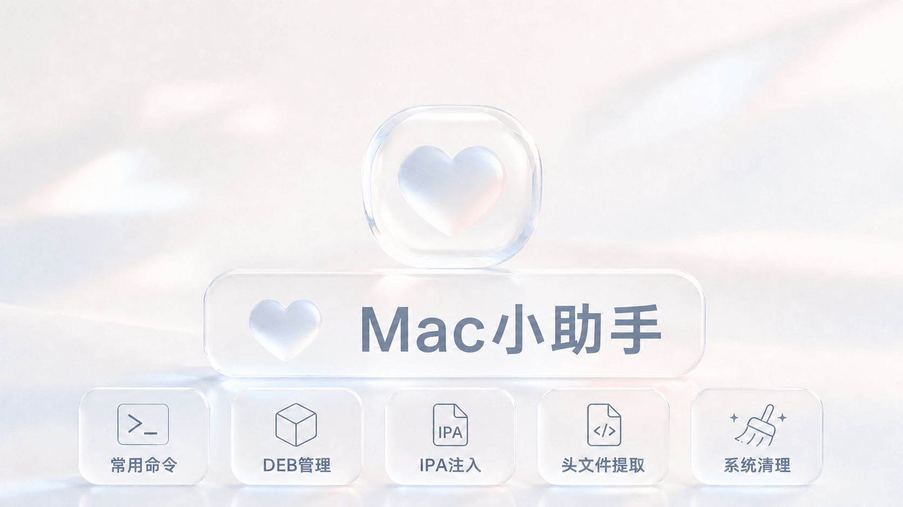
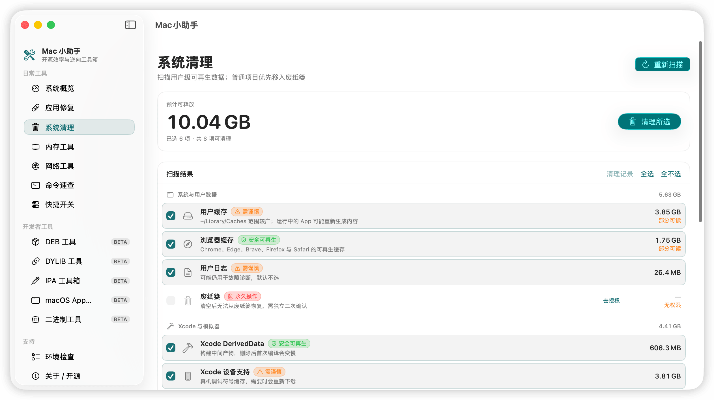

<p align="center">
  
</p>

<h1 align="center">MacAssistant</h1>

<p align="center">
  Native macOS toolkit for system care, app clones, app repair, commands, and sideloading.
</p>

<p align="center">
  <a href="docs/README.zh-CN.md">简体中文</a>
  · <a href="docs/README.es.md">Español</a>
  · <a href="docs/README.ko.md">한국어</a>
  · <a href="docs/README.ru.md">Русский</a>
</p>

<p align="center">
  <a href="https://github.com/iosrxwy/MacAssistant/actions/workflows/ci.yml"></a>
  
  
  <a href="LICENSE"></a>
</p>

<p align="center">
  <a href="https://github.com/iosrxwy/MacAssistant/releases"></a>
  <a href="https://x.com/iOSRXWY"></a>
  <a href="https://t.me/iosrxwy"></a>
</p>

<p align="center">
  
</p>

<p align="center">
  <sub>Live CPU, memory, disk, and battery. Screenshots in Simplified Chinese; six languages are in About.</sub>
</p>

## Everyday features

<table>
  <tr>
    <td align="center" width="50%" valign="top">
      
      <br>
      <b>Cleanup</b><br>
      Preview caches, Derived Data, Docker, and Time Machine before anything is deleted. Home directory only.
    </td>
    <td align="center" width="50%" valign="top">
      
      <br>
      <b>App clones</b><br>
      Isolated WeChat, browser, and editor copies — own data, optional per-clone proxy.
    </td>
  </tr>
  <tr>
    <td align="center" width="50%" valign="top">
      
      <br>
      <b>Desktop icons</b><br>
      Recolor Finder icons, or replace them with clay stickers, folder costumes, and AI folders.
    </td>
    <td align="center" width="50%" valign="top">
      
      <br>
      <b>IPA workbench</b><br>
      Drag in an IPA, inject plugins, thin, dump headers, and sign. Beta.
    </td>
  </tr>
  <tr>
    <td align="center" width="50%" valign="top">
      
      <br>
      <b>Mac app injection</b><br>
      Inject a dylib into a local <code>.app</code>, or copy first, then inject. Beta.
    </td>
    <td align="center" width="50%" valign="top">
      
      <br>
      <b>Environment check</b><br>
      Find missing tools (Theos, zsign, Homebrew, codesign…) and get setup steps.
    </td>
  </tr>
</table>

### More features

| Daily | Developer |
| --- | --- |
| App repair (“damaged” launches, quarantine, signatures, automatic update checks) | DEB create, inspect, convert, rebuild |
| Menu bar: battery, Wi-Fi, volume, Bluetooth, energy mode | Scan and remove injected plugins from a Mac app |
| Uninstall an app to the Trash (system apps stay) | DYLIB dependencies, install names, rpaths |
| Live memory pressure, process list, freeze and resume | |
| Network: throughput, ports, ping, DNS, public IP | IPA install / extract as-is (no FairPlay dump) |
| Searchable command library with risk labels | Mach-O inspection and class-dump |
| Quick toggles for Finder, screenshots, hidden files | Layered signing and Apple ID signing |

Preview before destructive actions. Open source, no telemetry.

Page backgrounds, sidebar glass, icon colors, and six interface languages live in **About**.

## Download

Universal Apple Silicon + Intel: [Releases](https://github.com/iosrxwy/MacAssistant/releases). macOS 13+.

Updates: [X @iOSRXWY](https://x.com/iOSRXWY) · [Telegram](https://t.me/iosrxwy)

### First launch blocked by macOS?

> [!IMPORTANT]
> This release is **ad-hoc signed and not notarized**. Open the app once, then go to **System Settings → Privacy & Security → Open Anyway**. Do not turn Gatekeeper off.

## Build

```bash
git clone https://github.com/iosrxwy/MacAssistant.git
cd MacAssistant
./build_app.sh release universal
open "dist/Mac小助手.app"
```

## Contributors

<table>
  <tr>
    <td align="center" width="120">
      <a href="https://github.com/iosrxwy"></a><br>
      <a href="https://github.com/iosrxwy"><b>iosrxwy</b></a><br>
      <sub>Author</sub>
    </td>
    <td align="center" width="120">
      <a href="https://github.com/codex"></a><br>
      <a href="https://github.com/codex"><b>Codex</b></a><br>
      <sub>Development</sub>
    </td>
    <td align="center" width="120">
      <a href="https://x.ai/grok"></a><br>
      <a href="https://x.ai/grok"><b>Grok Build</b></a><br>
      <sub>Development</sub>
    </td>
  </tr>
</table>

<p align="center">
  <a href="https://x.com/iOSRXWY">X</a>
  · <a href="https://t.me/iosrxwy">Telegram</a>
  · <a href="https://github.com/iosrxwy">GitHub</a>
  · <a href="CONTRIBUTING.md">Contributing</a>
</p>

## Thanks

[AltSign](https://github.com/rileytestut/AltSign) / [AltStore](https://github.com/altstoreio/AltStore) · [xtool](https://github.com/xtool-org/xtool) · [libimobiledevice](https://libimobiledevice.org) · [Theos](https://github.com/theos/theos) · [zsign](https://github.com/zhlynn/zsign) · [ATBClone](https://github.com/aitobox/ATBClone)

Folder looks are redrawn from the idea of [Moonvy Folder Dressing](https://moonvy.com/apps/dir-hz/). Their artwork is not included. Clay stickers and AI folders are original drawings.

## License

[GNU GPL-3.0](LICENSE). Distributed modifications must remain free software under the same license, with complete corresponding source.

Security reports: [SECURITY.md](SECURITY.md).
