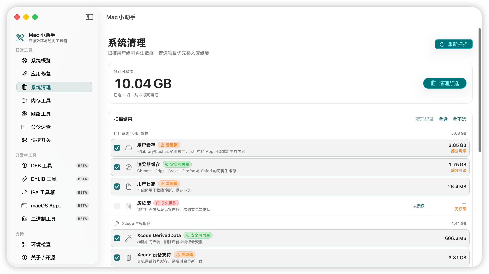

<p align="center">
  
</p>

<h1 align="center">Mac小助手</h1>

<p align="center">
  原生 Mac 工具箱：系统维护、应用分身、软件修复、命令速查、应用侧载。
</p>


<p align="center">
  <a href="../README.md">English</a>
  · <a href="README.es.md">Español</a>
  · <a href="README.ko.md">한국어</a>
  · <a href="README.ru.md">Русский</a>
</p>

<p align="center">
  <a href="https://github.com/iosrxwy/MacAssistant/actions/workflows/ci.yml"></a>
  
  
  <a href="../LICENSE"></a>
</p>

<p align="center">
  <a href="https://github.com/iosrxwy/MacAssistant/releases"></a>
  <a href="https://x.com/iOSRXWY"></a>
  <a href="https://t.me/iosrxwy"></a>
</p>

<p align="center">
  
</p>

<p align="center">
  <sub>实时 CPU、内存、磁盘、电池。界面语言可在「关于软件」切换。</sub>
</p>

## 常规功能

<table>
  <tr>
    <td align="center" width="50%" valign="top">
      
      <br>
      <b>系统清理</b><br>
      缓存、Derived Data、Docker、Time Machine 先预览再删，只动主目录。
    </td>
    <td align="center" width="50%" valign="top">
      
      <br>
      <b>应用分身</b><br>
      微信 / 浏览器 / 编辑器独立数据目录，可按分身配代理。
    </td>
  </tr>
  <tr>
    <td align="center" width="50%" valign="top">
      
      <br>
      <b>桌面图标</b><br>
      给文件、文件夹、应用换色，也可换成粘土贴纸、文件夹造型和 AI 文件夹。
    </td>
    <td align="center" width="50%" valign="top">
      
      <br>
      <b>IPA 工作台</b><br>
      拖入 IPA，注入插件、瘦身、头文件、签名。Beta。
    </td>
  </tr>
  <tr>
    <td align="center" width="50%" valign="top">
      
      <br>
      <b>Mac 应用注入</b><br>
      给本地 <code>.app</code> 注入 dylib，或先复制再注入。Beta。
    </td>
    <td align="center" width="50%" valign="top">
      
      <br>
      <b>环境检查</b><br>
      找出缺的工具（Theos、zsign、Homebrew、codesign…）并给出安装步骤。
    </td>
  </tr>
</table>


### 其他功能

| 日常工具 | 开发者工具 |
| --- | --- |
| 应用修复（已损坏、隔离属性、签名、关闭自动更新） | DEB 制作、检查、转换、重新打包 |
| 菜单栏：电量、Wi-Fi、音量、蓝牙、能耗模式 | 扫描并卸除 Mac 应用里注入的插件 |
| 把应用移到废纸篓（系统应用不动） | DYLIB 依赖、安装名、rpath |
| 实时内存压力、进程列表、冻结与恢复 | |
| 网络：速率、端口、Ping、DNS、公网 IP | IPA 安装 / 原样提取（不脱壳） |
| 可搜索的命令速查，带风险标识 | Mach-O 检查与 class-dump |
| 访达、截图、隐藏文件等快捷开关 | 逐层签名与 Apple ID 签名 |

破坏性操作前会预览。开源，无遥测。

页面背景、侧栏材质、图标颜色和六种界面语言在 **关于软件**。


## 下载

通用版（Apple Silicon + Intel）：[Releases](https://github.com/iosrxwy/MacAssistant/releases)。需要 macOS 13+。

发布动态：[X @iOSRXWY](https://x.com/iOSRXWY) · [Telegram](https://t.me/iosrxwy)


### 首次打开被拦截？

> [!IMPORTANT]
> 正式版是 **ad-hoc 签名，未经 Apple 公证**。先打开一次，再到 **系统设置 → 隐私与安全性 → 仍要打开**。不要全局关闭 Gatekeeper。


## 构建

```bash
git clone https://github.com/iosrxwy/MacAssistant.git
cd MacAssistant
./build_app.sh release universal
open "dist/Mac小助手.app"
```


## 贡献者

<table>
  <tr>
    <td align="center" width="120">
      <a href="https://github.com/iosrxwy"></a><br>
      <a href="https://github.com/iosrxwy"><b>iosrxwy</b></a><br>
      <sub>作者</sub>
    </td>
    <td align="center" width="120">
      <a href="https://github.com/codex"></a><br>
      <a href="https://github.com/codex"><b>Codex</b></a><br>
      <sub>开发</sub>
    </td>
    <td align="center" width="120">
      <a href="https://x.ai/grok"></a><br>
      <a href="https://x.ai/grok"><b>Grok Build</b></a><br>
      <sub>开发</sub>
    </td>
  </tr>
</table>

<p align="center">
  <a href="https://x.com/iOSRXWY">X</a>
  · <a href="https://t.me/iosrxwy">Telegram</a>
  · <a href="https://github.com/iosrxwy">GitHub</a>
  · <a href="../CONTRIBUTING.md">参与贡献</a>
</p>

## 致谢

[AltSign](https://github.com/rileytestut/AltSign) / [AltStore](https://github.com/altstoreio/AltStore) · [xtool](https://github.com/xtool-org/xtool) · [libimobiledevice](https://libimobiledevice.org) · [Theos](https://github.com/theos/theos) · [zsign](https://github.com/zhlynn/zsign) · [ATBClone](https://github.com/aitobox/ATBClone)

文件夹造型的灵感来自[月维「文件夹换装」](https://moonvy.com/apps/dir-hz/)，重新绘制，未收录对方的图。粘土贴纸和 AI 文件夹为原创绘制。推荐这个站点。


## 许可证

[GNU GPL-3.0](../LICENSE)。对外分发的修改版必须继续以同样许可证提供完整对应源代码。

安全问题见 [SECURITY.md](../SECURITY.md)。
